# Ecom 全栈智能体矩阵（四件套）可执行架构规格与全链路流程图手册（v2.1 完整图表版）

## 一、 架构修订原则与全局总览流程图

本手册基于对现有资产（`EcomNLU` 评论十分类与情感模型、`EcomRAG` 客服知识检索、`SmartVoyage` A2A+MCP 原型、`EduAgent` LangGraph+Vue3 原型）的严格代码审计与工程边界评估编制，内含**全局架构总览图、跨系统时序图、各子系统细分业务流程图、状态机图与数据实体 ER 图（共 13 张 Mermaid 图表）**。

### 1.1 核心工程准则（10 项边界收敛修正）

1. **模型能力与业务目录解耦**：`EcomNLU` 的 10 个固定标签（含品牌“蒙牛”、服务“酒店”等异构标签）保留为**评论实验模型标签**，不直接充当全站业务商品分类树；增加低置信度拒识（`ABSTAIN`）与分句候选，严禁对跨领域输入做强制硬过滤。
2. **明确“模拟支付的订单交易闭环”**：首版聚焦数据库级事务状态机、报价有效期核验、下单/取消/退款幂等键与优惠分摊计算，不虚构真实第三方资金清算。
3. **单一数据源（SSOT）与跨系统幂等回调**：废除模糊的“共享库”概念。C 端 `EcomPilot`（MySQL）独占订单与退款执行写权限；B 端 `EcomOps`（PostgreSQL）独占审核工单与审批流状态，跨系统通过带幂等键的内部 API + 异步对账通信。
4. **受控凑单优化替代宽泛“全局最优”承诺**：补齐 `shop_id` 与整型“分（`cents`）”计价，首版限定在“必买商品固定 + 限定候选凑单池（`<=15` 件）至多加购 2 件”的明确规则下通过穷举校核求解最低实付。
5. **认证鉴权与租户归属强校验**：严禁信任客户端传入的 `user_id` / `tenant_id`，统一从 JWT 凭据解析身份并校验资源归属；免订单号售后反查仅返回候选订单供用户确认，严禁自动选中退款。
6. **知识服务单一所有权与跨存储最终一致**：由 `EcomRAG` 唯一负责 `BGE-M3` 嵌入、Milvus 索引写入与混合检索；`EcomOps` 仅负责待补录问题审核流，通过 `待审核 → 发布中 → 已发布/发布失败` 状态机与确定性 `chunk_id` 实现 PG 与 Milvus 的幂等同步。
7. **按真实业务重绘 LangGraph 分支拓扑**：打破“节点数 1:1 僵化映射”，为售后审核增加风险条件路由（低风险自动放行、高风险才进入 `interrupt` 人工复核）及补材料、驳回、撤回、回调失败分支；清理客服训练中的原面试残留阶段名。
8. **合规审查采用“阻断项一票否决 + 待核实项转人工 + 建议项评分”**：废除用加权总分决定合规通过的做法；调用失败触发降级（`fallback_used=True`）时严禁以默认分放行。
9. **检查点持久化配合节点副作用幂等**：`AsyncPostgresSaver` 仅解决图状态保存；所有含外部写入的节点均须凭 `step_execution_id` 实现重入幂等，并配套超时挂起任务扫描恢复机制。
10. **“长期四项目矩阵 + 首版 MVP 单闭环先行”排期**：首版 MVP 集中打通 **「售后申请 → 条款检索 → 三轨审核 → 主管确认 → 模拟退款回写」** 核心闭环，导购凑单、种草、合规审查与客服训练按 Milestone 分批交付。

### 1.2 四项目矩阵定位总览

| 项目代号 | 仓库名与中文名 | 改造基座 | 端口 | 核心技术栈 | 角色定位 | 交付批次 |
| :--- | :--- | :--- | :--- | :--- | :--- | :--- |
| **项目一** | `EcomNLU`（智购感知） | 原 `ecommerce-text-classification` | `8001` | PyTorch / Transformers / FastAPI | 评论十类实验标签预测 + 正负向情感极性分析 + 低置信拒识（提供辅助信号） | **MVP (M1)** |
| **项目二** | `EcomRAG`（智购百科） | 原 `EcomRAG` + EduAgent 检索组件 | `8002` | FastAPI / BGE-M3 / CrossEncoder / Milvus `2.4.4` | **全系统唯一知识索引与检索服务**：管理带版本与生效期的售后规则、商品百科与 Milvus 向量库 | **MVP (M1)** |
| **项目三** | `EcomPilot`（智购领航） | `SmartVoyage` | `8085` (主API)<br>`8011~8015` (A2A) | FastAPI / A2A / MCP / MySQL `8.0` / SSE | **C 端交易与导购系统**：拥有商品目录、优惠券、订单状态机与模拟支付/退款执行权 | **MVP (M1 售后与订单内核)**<br>**M2/M3 (导购凑单与种草)** |
| **项目四** | `EcomOps`（智购中台） | `EduAgent` | `8000` (后端)<br>`3000` (Vue3) | FastAPI / LangGraph `1.0.9` / PostgreSQL `15` / Vue 3 | **B 端风控审批与运营实训平台**：拥有售后三轨审核与人工复核、知识补录审核、合规审查与客服对练工作流 | **MVP (M1 售后三轨审核)**<br>**M2/M4 (知识飞轮/合规/实训)** |

### 1.3 【图 1-1：全局总览】Ecom 四件套系统分层、SSOT 存储边界与跨系统调用全景图

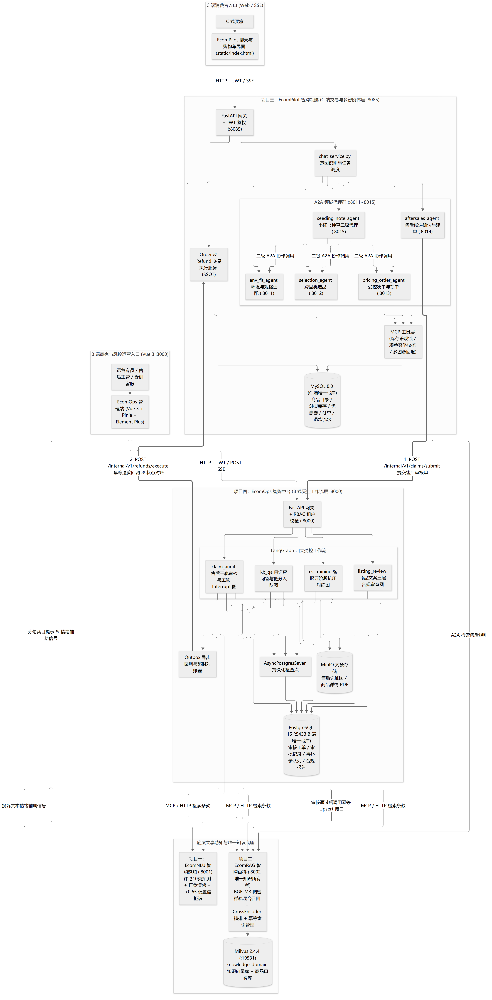

[查看可缩放矢量图](01_全局系统架构与存储边界图.svg)

### 1.4 【图 1-2：MVP 闭环总览】C 端售后申请 → B 端三轨审核 → 主管审批 → 模拟退款回写与超时对账时序图

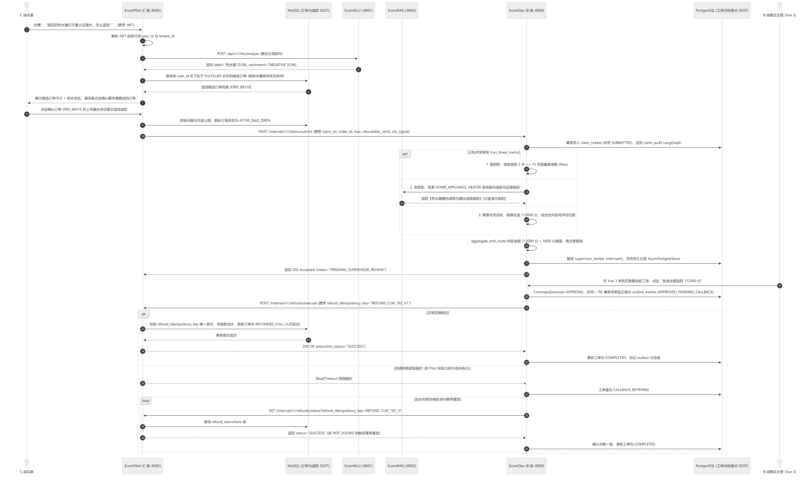

[查看可缩放矢量图](02_售后审核与模拟退款闭环时序图.svg)

## 二、 规格一：系统责任边界与感知/安全细分流程图

### 2.1 跨系统单一数据源（SSOT）划分表

| 业务领域实体 | 唯一拥有者（SSOT） | 物理存储 | 允许写操作方 | 外部系统读取/触发方式 |
| :--- | :--- | :--- | :--- | :--- |
| **业务商品目录 (`catalog_categories`, `products_sku`)** | `EcomPilot` | MySQL | `EcomPilot` 交易/库存模块 | `EcomOps` 通过只读 API 查询商品快照 |
| **订单、库存锁、优惠券核销、退款执行流水 (`orders`, `refund_executions`)** | `EcomPilot` | MySQL | `EcomPilot` 交易服务 | `EcomOps` 审批通过后，调用 `EcomPilot` 内部幂等退款接口触发执行 |
| **售后审核工单、三轨评估结果、主管审批记录 (`claim_tickets`, `claim_approvals`)** | `EcomOps` | PostgreSQL | `EcomOps` 售后工作流与审批接口 | `EcomPilot` 通过 API 提交售后申请单并查询审核进度 |
| **知识文档、分块元数据、向量索引 (`knowledge_docs`, Milvus `knowledge_domain`)** | `EcomRAG` | Milvus + 本地存储 | `EcomRAG` 索引管理服务 | `EcomPilot` 与 `EcomOps` 均通过 HTTP/MCP 调用 `EcomRAG` 检索；`EcomOps` 审核通过的待补录知识调用 `EcomRAG` 发布接口入库 |
| **待补录问题审核队列 (`knowledge_pending_queue`)** | `EcomOps` | PostgreSQL | `EcomOps` 问答工作流与运营审核台 | 运营点击发布后，由 `EcomOps` 后台任务调用 `EcomRAG` 写入接口 |
| **商品文本合规审查报告、客服对练会话 (`listing_reviews`, `training_sessions`)** | `EcomOps` | PostgreSQL + MinIO | `EcomOps` 对应工作流 | 仅 B 端内部按 `tenant_id` 隔离访问 |

### 2.2 【图 2-1：细分流程】`EcomNLU` 分句推理、低置信拒识 (`ABSTAIN`) 与业务目录解耦流程图

针对原十分类模型基于评论数据训练的特点，通过**输入场景守卫 + 分句切分 + `0.65` 拒识阈值 + 软映射表**防止跨领域误杀：

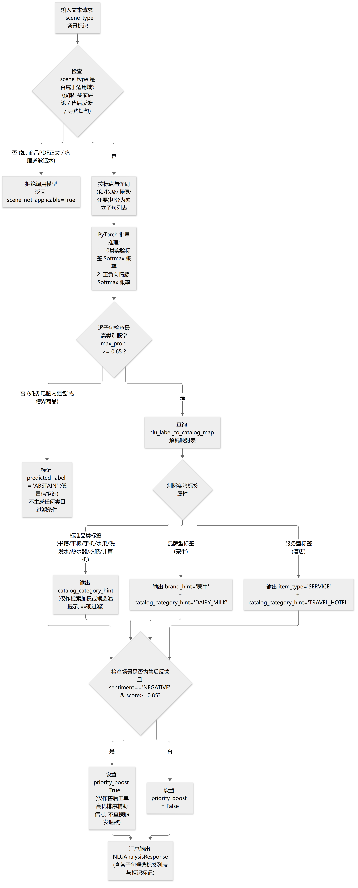

[查看可缩放矢量图](03_分句推理与低置信拒识流程图.svg)

### 2.3 【图 2-2：细分流程】JWT 认证鉴权、多租户会话隔离与“免订单号反查候选确认”安全流程图

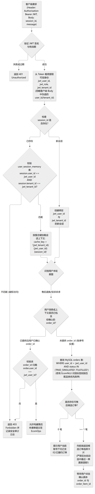

[查看可缩放矢量图](04_身份鉴权与售后订单确认流程图.svg)

## 三、 规格二：C 端 `EcomPilot` 与 B 端 `EcomOps` 细分业务流程图与状态机

### 3.1 【图 3-1：细分状态机】`EcomPilot` 订单全生命周期、库存锁与模拟支付/部分退款状态图

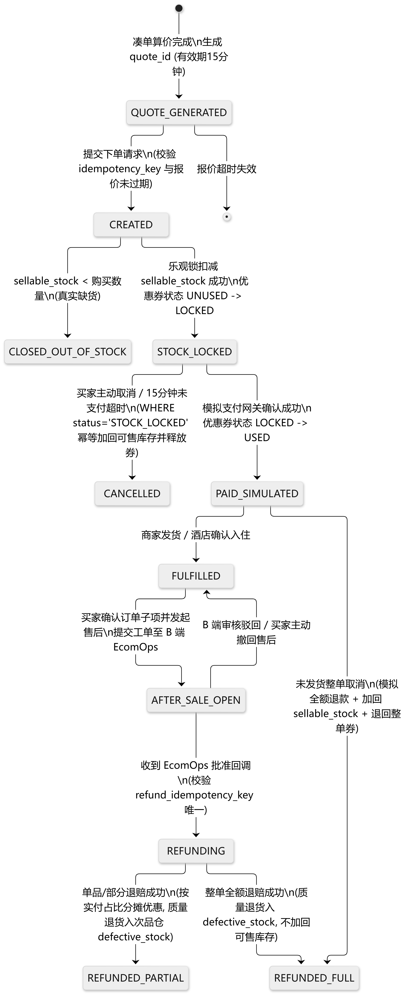

[查看可缩放矢量图](05_订单生命周期与退款状态图.svg)

### 3.2 【图 3-2：细分流程】`EcomPilot` 报价二次核价、乐观锁防超卖（区分版本冲突与缺货）及幂等下单流程图

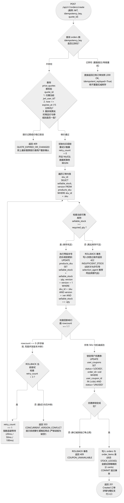

[查看可缩放矢量图](06_核价库存锁与幂等下单流程图.svg)

### 3.3 【图 3-3：细分流程】`EcomPilot` 跨品类选品、受控凑单算价（`<=15` 候选池穷举）与小红书两层 A2A 协作图

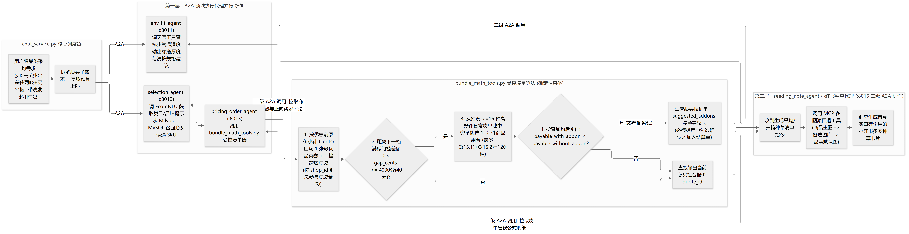

[查看可缩放矢量图](07_跨品类选品凑单与种草协作图.svg)

### 3.4 【图 3-4：细分流程】`EcomOps` 售后理赔三轨审核 (`claim_audit` LangGraph) 与 `interrupt/resume` 完整分支图

打破原 `Exam` 图无条件进入人工中断的线性限制，引入风险条件分流、四类主管决策、买家撤回与幂等回调对账：

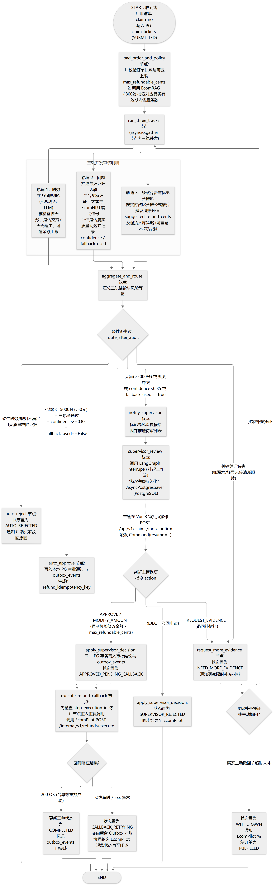

[查看可缩放矢量图](08_售后理赔三轨审核与人工复核图.svg)

### 3.5 【图 3-5：细分流程】`EcomOps` ⇄ `EcomPilot` 跨库异步回调与网络超时对账恢复流程图

专门回答“主管已批准，但回写 C 端时网络超时，系统怎么判断退款到底执行了没有”这一核心分布式一致性问题：

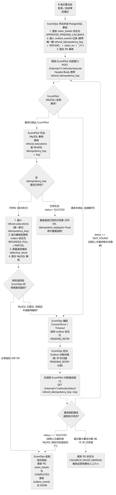

[查看可缩放矢量图](09_跨库异步回调与超时对账恢复图.svg)

### 3.6 【图 3-6：细分流程】`EcomOps` (`kb_qa` LangGraph) ⇄ `EcomRAG` 多策略混合检索与知识补录幂等发布飞轮图

明确 **`EcomRAG (:8002)` 是全系统唯一的知识向量化与 Milvus 索引所有者**，`EcomOps` 通过确定性 `chunk_id` 与四态状态机实现跨 PG-Milvus 幂等发布：

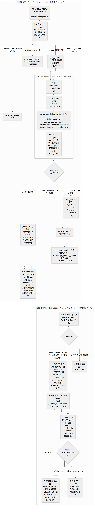

[查看可缩放矢量图](10_混合检索与知识补录发布飞轮图.svg)

### 3.7 【图 3-7：细分流程】`EcomOps` 商品详情页文案合规审查 (`listing_compliance_review`) 三层结构化判定流程图

废除“加权总分抵消违规项”的做法，明确三层结构化输出与降级强制转人工规则：

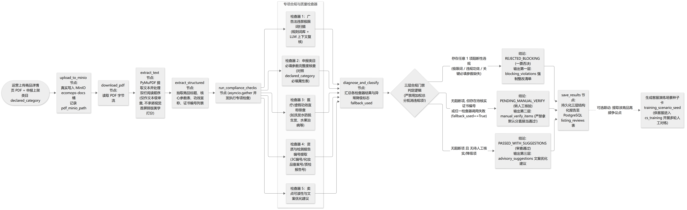

[查看可缩放矢量图](11_商品文案三层合规审查流程图.svg)

### 3.8 【图 3-8：细分流程】`EcomOps` 金牌电商客服五阶段抗压对练 (`cs_training`) 与记忆摘要修复流程图

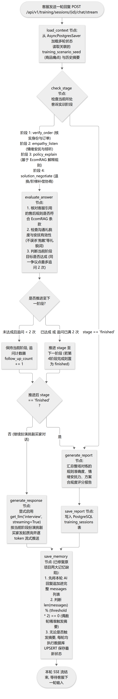

[查看可缩放矢量图](12_客服五阶段抗压对练与记忆流程图.svg)

## 四、 规格三：跨系统数据库实体关系（ER 图）与核心接口契约

### 4.1 【图 4-1：数据模型总览】`EcomPilot` (MySQL) 与 `EcomOps` (PostgreSQL) 跨系统实体关系与边界图

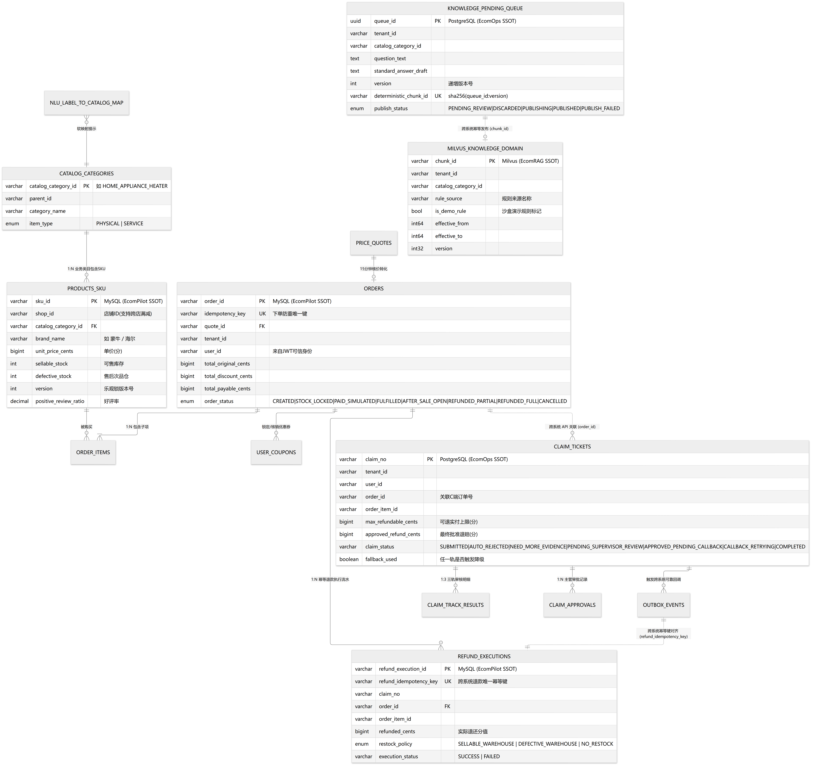

[查看可缩放矢量图](13_跨系统数据实体关系与边界图.svg)

### 4.2 跨系统核心接口 JSON 契约

#### 1. `EcomPilot` 向 `EcomOps` 提交售后审核单：`POST /internal/v1/claims/submit`
```json
{
  "claim_no": "CLM_20261031_000182",
  "tenant_id": "SHOP_SELF_01",
  "user_id": "USR_99201",
  "order_id": "ORD_20261029_88310",
  "order_item_id": "ITEM_01",
  "sku_id": "SKU_HEATER_003",
  "catalog_category_id": "HOME_APPLIANCE_HEATER",
  "item_payable_cents": 112000,
  "max_refundable_cents": 112000,
  "days_since_delivery": 5,
  "claim_type": "QUALITY_REFUND",
  "buyer_reason_text": "这台热水器装好第二天就打不着火，底部还有点漏水，太坑了要求全额退货退款！",
  "evidence_urls": ["https://storage.example.invalid/evidence/evidence_01.jpg"],
  "nlu_signal": {
    "predicted_label": "热水器",
    "category_confidence": 0.98,
    "sentiment": "NEGATIVE",
    "sentiment_score": 0.96,
    "priority_boost": true
  }
}
```

#### 2. `EcomOps` 审批通过后回调 `EcomPilot` 执行模拟退款：`POST /internal/v1/refunds/execute`
```json
{
  "refund_idempotency_key": "REFUND_CLM_20261031_000182_V1",
  "claim_no": "CLM_20261031_000182",
  "order_id": "ORD_20261029_88310",
  "order_item_id": "ITEM_01",
  "approved_refund_cents": 112000,
  "restock_policy": "DEFECTIVE_WAREHOUSE",
  "approval_mode": "SUPERVISOR_CONFIRMED",
  "supervisor_user_id": "SUP_007",
  "approved_at": "2026-10-31T20:45:00+09:00"
}
```

#### 3. `EcomPilot` 退款执行响应与对账查询契约：`GET /internal/v1/refunds/status?refund_idempotency_key=...`
```json
{
  "refund_idempotency_key": "REFUND_CLM_20261031_000182_V1",
  "refund_execution_id": "RF_EXEC_77419",
  "order_id": "ORD_20261029_88310",
  "execution_status": "SUCCESS",
  "order_status_after": "REFUNDED_FULL",
  "refunded_cents": 112000,
  "idempotent_replayed": false,
  "executed_at": "2026-10-31T20:45:01+09:00"
}
```

## 五、 规格四：可判定验收用例与分阶段演进路线图

### 5.1 分阶段交付路线图（MVP 核心单闭环先行）

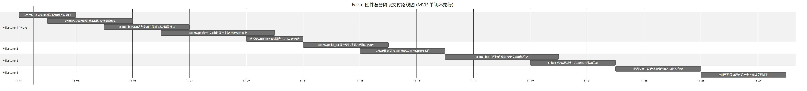

[查看可缩放矢量图](14_分阶段交付路线图.svg)

| 里程碑阶段 | 聚焦目标与核心范围 | 涉及模块 | 明确暂不纳入本阶段的内容（防范围蔓延） |
| :--- | :--- | :--- | :--- |
| **Milestone 1 (MVP)**<br>**跨系统售后审核与模拟退款闭环** | 完整跑通：**C 端订单查询与候选确认 → `EcomNLU` 辅助信号提取 → `EcomRAG` 条款混合检索 → `EcomOps` 三轨审核与条件分流 → 主管 Vue 3 `interrupt/resume` 审批 → `EcomPilot` 幂等模拟退款回写与对账** | 1. `EcomNLU` 预测与拒识接口<br>2. `EcomRAG` 售后规则检索接口<br>3. `EcomPilot` 订单表、售后申请与幂等退款接口<br>4. `EcomOps` 的 `claim_audit` 图、`AsyncPostgresSaver` 与主管审批页 | 暂不开发跨店凑单、小红书多图种草、酒店天气联动、商品 PDF 审查与客服多轮对练 |
| **Milestone 2**<br>**RAG 知识补录飞轮与修复基线** | 跑通：`EcomOps` 的 `kb_qa` 自适应问答 → 低分（`<0.75`）入队 `knowledge_pending_queue` → 运营在 Vue 3 补录发布 → 调用 `EcomRAG` 幂等写入 Milvus → C/B 两端立即检索生效；同时修复摘要奇数取模与落库缩进 Bug | 1. `EcomOps` 的 `kb_qa` 图与待补录页面<br>2. `EcomRAG` 的 `/internal/v1/kb/upsert` 幂等写入接口<br>3. `memory.py` 摘要触发与落库修复 | 暂不接入复杂的外部爬虫知识源 |
| **Milestone 3**<br>**C 端场景选品、受控凑单与模拟支付下单** | 跑通：`EcomPilot` 多租户会话隔离、带报价有效期的受控凑单算价器、乐观锁防超卖锁单（区分缺货与版本冲突）、模拟支付与未发货幂等取消、小红书种草笔记二级 A2A 生成 | `EcomPilot` 的 `selection_agent`、`pricing_order_agent`、`env_fit_agent`、`seeding_note_agent` 及前端购物车抽屉 | 不对接真实微信/支付宝资金通道 |
| **Milestone 4**<br>**B 端文案合规审查与客服多轮对练** | 跑通：`listing_compliance_review`（三层结构化合规输出：阻断项/待核实项/建议项 + MinIO 真实存储）与 `cs_training`（五阶段挑剔买家抗压对练 + 显式流式输出） | `EcomOps` 的其余两条 LangGraph 工作流及对应 Vue 3 页面 | 不承诺视觉排版美学打分与外部官方证书联网验真 |

### 5.2 可判定自动化验收用例清单（Verifiable Acceptance Criteria）

| 用例编号 | 测试场景描述 | 触发操作与注入故障 | 通过判定标准（Pass Criteria） |
| :--- | :--- | :--- | :--- |
| **AC-TX-01** | **下单并发重试幂等性** | 使用相同 `idempotency_key` 与 `quote_id` 并发发送 5 次 `POST /api/v1/orders/create` 请求 | 1. MySQL `orders` 表中仅生成 **1 条**订单记录；<br>2. SKU 的 `sellable_stock` 仅扣减 **1 次**采购数量；<br>3. 其余 4 次请求均返回 `200 OK` 及完全相同的 `order_id`。 |
| **AC-TX-02** | **乐观锁版本冲突与真实缺货区分** | SKU 库存设为 `10`；模拟 2 个不同用户同时购买数量 `2`（注入相同初始 `version` 制造冲突），以及第 3 个用户购买数量 `20` | 1. 两个买 `2` 件的请求经服务端内部退避重试后**均下单成功**，剩余库存为 `6`，不返回 `OUT_OF_STOCK`；<br>2. 买 `20` 件的请求立即返回 `INSUFFICIENT_STOCK`，库存保持 `6`。 |
| **AC-TX-03** | **重复取消订单防刷库存** | 对同一笔处于 `STOCK_LOCKED` 状态的订单连续调用 3 次取消接口 | 1. 第 1 次返回取消成功，订单状态变为 `CANCELLED`，库存加回 1 次；<br>2. 第 2、3 次返回幂等成功提示，**库存绝不重复增加**。 |
| **AC-TX-04** | **LangGraph 审批挂起后进程重启与单次退款保证** | 提交一笔理赔额 `112000` 分的热水器售后单使其挂起在 `supervisor_review: interrupt()`；**重启 `EcomOps` 后端进程**；随后主管并发点击 2 次“批准退款”，且首次回调 `EcomPilot` 时注入网络读取超时 | 1. 进程重启后，主管仍能从 `AsyncPostgresSaver` 正常读取挂起态并恢复工作流；<br>2. 对账重试机制最终将工单推进至 `COMPLETED`；<br>3. `EcomPilot` 的 `refund_executions` 表中仅存在 **1 条**退款记录，订单实退金额严格等于 `112000` 分。 |
| **AC-SEC-01** | **跨用户越权访问拦截与免单号反查确认** | 用户 A 携带自身 JWT，在请求参数中伪造用户 B 的 `order_id` 申请售后；以及用户 A 发起不带订单号的售后吐槽 | 1. 伪造他人 `order_id` 的请求直接返回 `403 Forbidden` 或 `404 Not Found`；<br>2. 免单号吐槽仅返回用户 A 自己的候选订单列表，`claim_tickets` 表中在用户二次确认前**不生成**任何记录。 |
| **AC-KB-01** | **知识补录发布失败重试无重复向量** | 运营发布一条待补录知识，首次写入 Milvus 成功后人为中断 PG 状态回写（使状态停留在 `PUBLISHING` / `PUBLISH_FAILED`），随后点击重试发布 | 1. PG 状态最终变为 `PUBLISHED`；<br>2. 在 Milvus `knowledge_domain` 中按该 `chunk_id` 查询，**仅存在 1 条记录**，无重复向量副本。 |
